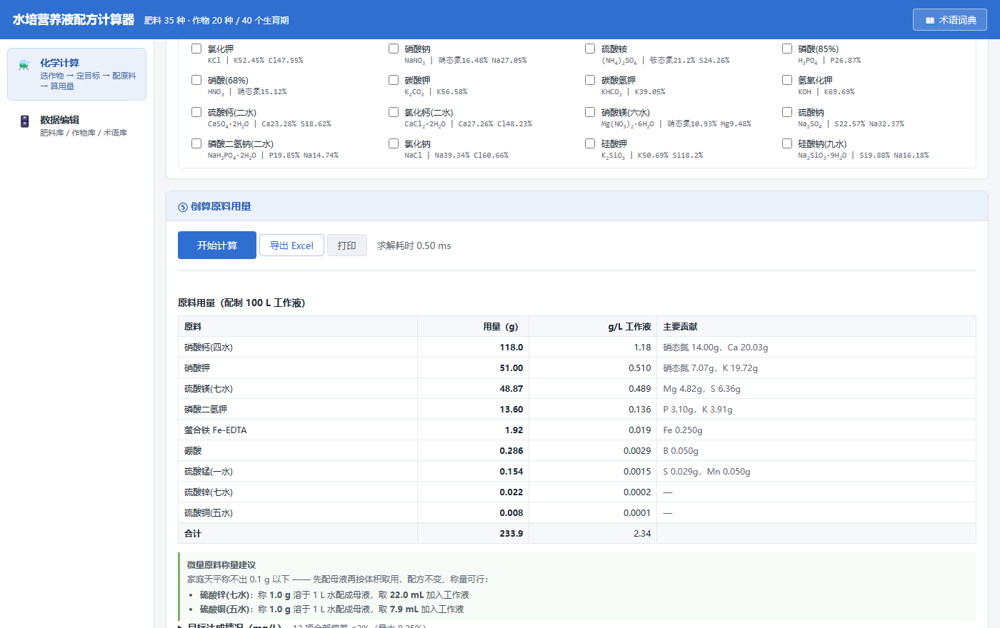

# Hydroponic Nutrient Solution Calculator

[中文](README.md) | English

---

> Pick a crop and growth stage → the nutrient targets (mg/L) load automatically → linear least squares back-solves how many grams of each fertilizer to weigh out.
>
> A Tauri 2 desktop app and a single-file HTML app — **two forms**, one shared source tree and dataset.

[](LICENSE)
[](#known-limitations)
[](https://tauri.app)
[](#core-implementation)


---

## What problem does it solve

When you mix a hydroponic nutrient solution, the hard part is not "which fertilizers to use" — it is **"how many grams to weigh out"**:

- Every fertilizer has a different composition — calcium nitrate is 15.5% N and 20.3% Ca, potassium nitrate 13.85% N and 38.67% K…
- A single fertilizer **supplies several elements at once**, and those supplies are coupled: weigh in a little extra calcium and the nitrogen comes along with it
- A recipe table gives you **concentrations** (mg/L), but what you put on the scale is **grams**
- Done by hand, you lose track of one element while fixing another — especially the micronutrients, which live at the 0.01 ppm scale

This tool formulates "target concentrations + selected fertilizers" as a **system of linear equations** and solves it,
then tells you how much each fertilizer contributed, which element missed its target, and how much deviation the water of crystallization form introduces.

## Features

| Feature | Description |
| --- | --- |
| **Automatic target loading** | Switching crop or growth stage loads that stage's nutrient targets automatically — no button to press |
| **Smart fertilizer recommendation** | Standard combinations first + weighting by required amount + domain constraints + deviation-driven topping up |
| **Back-calculated doses** | Linear least squares for a non-negative solution; negative doses are dropped and the system re-solved |
| **Deviation visualization** | Achieved value and deviation percentage for every element, highlighted once past the threshold |
| **Hydrate form check** | Did you buy the monohydrate or the heptahydrate? At the same weight, the element content can differ by a factor of two |
| **Source water baseline** | Enter your tap/well water test values and they are subtracted from the targets automatically |
| **Stock solution A/B splitting** | Calcium fertilizers must not be mixed with sulfates/phosphates at high concentration (they precipitate); the app tells you how to split the tanks |
| **Micronutrient weighing advice** | When the scale cannot resolve below 0.1 g, make a stock solution first and measure it out by volume |
| **In-page data editing** | The fertilizer / crop / glossary libraries can be edited directly, and the changes are saved on this machine |
| **CSV import and export** | Edit in Excel and import back; the import auto-detects UTF-8 and GBK |
| **Excel export** | A `.xlsx` with 4 worksheets whose numbers stay live |
| **Glossary** | 34 technical terms, each explaining what it means and **how it affects your crop** |

### Interface

| Chemical calculation | Fertilizer selection (formulas auto-subscripted) | Data editing |
| --- | --- | --- |
|  |  |  |

---

## Two forms, one source

| Form | Artifact | Best for |
| --- | --- | --- |
| **Tauri desktop build** | `水培营养液配方计算器-便携版.exe` (portable edition, 10.3 MB)<br>+ NSIS installer + MSI | A standalone application window; export uses the system "Save As" dialog and shows the real save path |
| **Single-file HTML** | `水培营养液计算器.html` (calculator, ~150 KB) | Double-click to run on any computer — zero dependencies, and it fits on a USB stick |

> **The two artifacts cannot drift apart**: both are generated from `src/` and `data/` by the `npm run build` family of commands,
> and there is no second, hand-written copy of the code. `test/baseline.mjs` verifies that both produce **bit-for-bit identical** results.

```bash
npm run build          # → dist/index.html (the frontend artifact Tauri loads)
npm run build:single   # → also emits a standalone single-file HTML
```

---

## Quick start

Prerequisites: Node.js 18+ and a Rust toolchain. (Building the desktop app also requires Windows + WebView2.)

```bash
git clone <repository-url> && cd hydroponic-calculator
npm install                # esbuild / eslint / Tauri CLI
npm run build              # produces dist/index.html
npm run tauri:dev          # dev mode: a hot-reloading window
npm run tauri:build        # release artifacts (portable exe + installers)
```

> `dist/` is not committed (it is a build artifact), but `data/*.csv` is committed,
> so you can clone the repository and run `npm run build` right away — **no Python install required**.
> The scripts under `tools/` are only needed when you change a fertilizer's chemical formula, add a crop, or add a glossary term.

The first `tauri:build` compiles every Rust dependency from scratch and takes about 10 minutes.

**One-command build (on a clean Windows machine)**:

```bat
build-windows.bat
```

The script checks the Node.js / Rust / WebView2 runtime itself, prints install instructions when something is missing,
then runs the frontend build and the Tauri packaging, and copies the artifacts to the project root.

---

## Core implementation

### The solver: why not ordinary least squares

Let `A` be the "fertilizer × element" composition matrix, and let the system to solve be `Ax = b`, where `b` is the target nutrient amounts.
The difficulties are:

1. **The number of equations does not match the number of unknowns.** There may be more fertilizers than elements (underdetermined) or fewer (overdetermined).
   The solution branches on dimension: when `m ≤ n`, `x = Aᵀ(AAᵀ)⁺b`; otherwise, `x = (AᵀA)⁺Aᵀb`.
   The pseudoinverse is implemented by hand with a **Jacobi eigendecomposition**, pulling in no matrix library.

2. **Relative error must be minimized, not absolute error.**
   This is the most important insight in the project: among the targets, Cu is only 0.02 ppm while K is 300 ppm.
   Minimize absolute error directly and the Cu deviation is completely swamped by K — copper comes out either at 0 or off by a factor of 100.
   So **each row is normalized by its target value** before solving, giving every element an equal say.

3. **The solution comes out with negative doses.** That is physically impossible to carry out (you cannot weigh out a negative amount of fertilizer),
   so the solver iterates: drop the most negative variable, re-solve, and repeat until every dose is non-negative.

4. **Domain constraints.** Macro elements may only be supplied by fertilizers in the "macro" (大量) class, and micro elements only by the "micro" (微量) class.
   This rule came from a real incident: with no constraint, the solver found that ammonium molybdate was the easiest way to balance the anions,
   and molybdenum ended up 148× over target — while the safe window for Mo is extremely narrow for most crops.

### Chemical formula engine

Fertilizer composition **comes from no database at all**: it is computed directly from the chemical formula.

```
Ca(NO3)2·4H2O  →  N 11.86%  Ca 16.97%   (with water of crystallization)
MgSO4          →  Mg 9.86%  S 13.01%    (anhydrous)
```

It supports nested parentheses, water of crystallization (`·nH2O`), and hydrate/anhydrous conversion, with IUPAC atomic weights.
Change the formula and the content is recomputed automatically — that is what makes the data maintainable.

**Chemical formulas are always pure ASCII in the data layer** (`Ca(NO3)2·4H2O`), and are converted only for display:

| Context | Conversion function | Result |
| --- | --- | --- |
| Web UI | `formatFormula` → `<sub>` | `Ca(NO₃)₂·4H₂O` |
| Excel export | `toUnicodeSubscript` → Unicode | `Ca(NO₃)₂·4H₂O` |

Unicode subscripts are not stored in the CSV directly because users could not type them while editing, and searching and sorting would break down.

### Excel export: written by hand, zero dependencies

SheetJS / ExcelJS would add several hundred KB to the single-file artifact, and all this project needs is "write the table out as Excel".
`src/core/xlsx.js` implements it in about 320 lines:

- ZIP in **store mode** (no compression) — no deflate implementation required, and the ZIP spec allows it anyway
- Strings as **inlineStr** — no sharedStrings table, no index to maintain
- Hand-written CRC32, local file headers, central directory

It produces 4 worksheets: **配方信息 (Recipe info) / 原料用量 (Fertilizer doses) / 目标达成 (Target achievement) / 形态核对 (Hydrate check)**.
Numbers are always written as **numeric types** (not strings), so in Excel you can sum them, scale them, and chart them directly.

> **Why a hand-written ZIP still needs cross-validation**: xlsx = ZIP + XML, and a hand-written ZIP is most likely to go wrong in the CRC32 or the
> central-directory offsets — and **self-testing can never find those** (your own reader reading your own writer). Hence:
>
> ```bash
> node test/recipe-export-check.mjs      # real recipe → xlsx
> python test/verify-recipe.py           # read back and verify with openpyxl (a third-party implementation)
> ```
>
> The file is only truly verified once openpyxl opens it and correctly restores the numeric types, the Unicode subscripts, and the total check.

### Why the Rust side is only a few dozen lines

All business logic lives in the frontend; Rust does exactly two things: **open the window** and **register the "Save As" (另存为) plugin**.

The payoff is that the Tauri build and the HTML build share 100% of the business code, so any change happens in exactly one place.
The only thing that has to fork is "saving a file" — Blob downloads via `a[download]` are unreliable inside WebView2,
so the desktop build uses `plugin-dialog.save` + `plugin-fs.writeFile`, while the browser build falls back to a Blob download.

---

## Directory structure

```
hydroponic-calculator/
├── src/                    frontend source (plain ESM, no framework)
│   ├── core/                 pure logic layer: zero DOM dependencies, directly testable in Node
│   │   ├── constants.js        nutrient metrics, element groups, CSV column contract
│   │   ├── utils.js            number parsing and formatting
│   │   ├── solver.js           linear least squares (Jacobi eigendecomposition + pseudoinverse)
│   │   ├── chem.js             chemical formula engine (including water of crystallization detection)
│   │   ├── xlsx.js             minimal xlsx writer (ZIP store + inlineStr)
│   │   ├── data.js             data model and CSV encode/decode
│   │   └── calculator.js       recipe calculation and smart recommendation
│   ├── ui/
│   │   ├── html.js             template layer: pure functions, data → HTML string
│   │   ├── sheets.js           results → Excel worksheet structures (pure functions)
│   │   └── view.js             view layer: the only module that touches the DOM
│   ├── template.html           page skeleton (with build placeholders)
│   ├── style.css               stylesheet (including @media print)
│   └── main.js                 entry point
├── data/                   data sources (CSV; edit in Excel and rebuild)
│   ├── fertilizers.csv         fertilizer library, 35 entries (composition computed from formulas)
│   ├── crops.csv               crop library, 40 growth stages
│   └── glossary.csv            glossary, 34 entries (including "how it affects your crop")
├── dist/                   build output → Tauri loads this directory (not committed)
├── src-tauri/              Rust shell (deliberately kept minimal)
│   ├── src/lib.rs              window registration + dialog/fs plugins
│   ├── src/main.rs             entry point
│   ├── tauri.conf.json         window, bundling, Chinese product name
│   ├── capabilities/           minimal permission set
│   └── icons/                  application icons
├── test/
│   ├── core.test.mjs           64 unit tests (Node's built-in test runner)
│   ├── baseline.mjs            computation baseline: bit-for-bit comparison of the two forms
│   ├── baseline.json           baseline data
│   ├── xlsx-check.mjs          synthetic cases for the xlsx writer
│   ├── recipe-export-check.mjs real-recipe export
│   ├── verify-xlsx.py          cross-validation with openpyxl (synthetic cases)
│   ├── verify-recipe.py        cross-validation with openpyxl (real recipe)
│   ├── browser-check.ps1       browser end-to-end verification (29 assertions)
│   └── capture.ps1             full-page screenshot (CDP, for visual regression)
├── tools/                  build-time tools (not part of the running app)
│   ├── build-fertilizers.mjs   generate the fertilizer CSV from formulas (reuses core/chem.js)
│   ├── build-crops.mjs         generate the crop CSV
│   ├── build-glossary.mjs      generate the glossary CSV
│   ├── sources/                knowledge data (JSON): fertilizer list / crop targets / glossary definitions
│   ├── gen-icon.py             generate the icon source image (Pillow, one-off)
│   └── app-icon.png            icon source image
├── docs/
│   ├── screenshots/            UI screenshots
│   ├── ui-review.md            UI review and improvement log
│   └── acceptance-checklist.md delivery acceptance checklist
├── build.mjs               frontend build: ESM → IIFE → inlined single-file HTML
└── build-windows.bat       one-command build (GBK encoded, runs directly under cmd.exe)
```

## Key differences from the browser build

| Capability | Browser / single-file HTML | Tauri desktop build |
| --- | --- | --- |
| Export CSV | Blob download (you cannot see where the file went) | **System "Save As" + a real write to disk**, with the save path shown in the UI |
| Import CSV | `<input type=file>` + GBK fallback | **The same** (the web file input works in WebView2) |
| Export Excel | Yes (Blob download) | **Yes** (system "Save As"), 4 worksheets |
| Printing | Browser Ctrl+P | A "打印" (Print) button (the Tauri window has no menu bar) |
| Data storage | Browser localStorage | The WebView2 user data directory (determined by `identifier`) |

> **Note**: `identifier` (`com.hydroponic.calculator`) determines where the data directory lives and
> **must not be changed after release**, or users' existing data will appear to be lost.

---

## Code conventions

### Rust side: no construct that can panic

- **`unwrap()` / `expect()` / `panic!` / `unreachable!` are banned.**
  A release build sets `windows_subsystem = "windows"`, which means **no console**.
  The moment something panics, all the user sees is "I double-clicked and nothing happened" — they cannot even get the error message.
  `src/lib.rs` therefore turns a failed startup into a **native message box followed by a non-zero exit code**.
- Errors propagate with `Result` + `?` (the `setup` closure returns a `Result`) and are handled in one place higher up;
  exceptional cases such as a missing main window return `Err` to that single exit point instead of panicking.

### Frontend: both storage and parsing must tolerate failure

- Every `localStorage` read and write goes through the two wrappers `readStoredJSON` / `writeStoredJSON`:
  - Read failure (data hand-edited into a broken state, or an old-version format) → warn + **fall back to the built-in data**, without aborting startup
  - Write failure (quota exhausted, `QuotaExceededError`) → tell the user to switch to "导出 CSV" (Export CSV) for backup
- Missing or unparsable inline data → return an empty array and warn, **never throw**
- The critical DOM elements (`REQUIRED_ELEMENT_IDS`) are validated in one pass at startup:
  a missing element shows an explicit reason instead of letting `byId(...).addEventListener` throw and blank the page

---

## Data sources

- **Fertilizer composition**: computed precisely from the chemical formula + IUPAC atomic weights, then checked item by item against accepted textbook values
  (`npm run data:build` prints a self-check comparison table)
- **Crop nutrient targets**: public literature, with the source annotated on every row
  (Hoagland & Arnon, the Japanese Enshi formula, Yamazaki, the Agricultural University of Athens recipe tables, SARE, IARI)
- **Element concentrations with no reliable literature source are not invented** — they are left blank instead

## Rebuilding the data

After changing a formula, adding a crop, or adding a glossary term, regenerate the data:

```bash
npm run data:build                 # rebuild the fertilizer / crop / glossary libraries in order
```

They can also be rebuilt one at a time:

```bash
node tools/build-fertilizers.mjs   # recompute fertilizer composition from the formulas (with a textbook-value self-check)
node tools/build-crops.mjs         # crop nutrient targets
node tools/build-glossary.mjs      # glossary
```

The **knowledge data** (fertilizer list, crop targets, glossary definitions) lives in `tools/sources/*.json`;
the **computation logic** reuses `src/core/chem.js` directly — there is **only one chemistry implementation** across build time and run time.

> This is a hard constraint in this repository. Previously `build_fertilizers.py` and `core/chem.js` each kept their own chemistry parser and hydrate hint,
> and **they had measurably drifted**: the CSV said "请在 CSV 中把化学式改为 X 后重新导入"
> ("change the formula to X in the CSV and re-import"), while the live UI recomputation said "请把化学式改为 X"
> ("change the formula to X") — one feature, two different wordings.
> Both are now provided by `core/chem.js`, and the Python version has been deleted.

> **These scripts take no part in running the app.** Their output is `data/*.csv`,
> which `npm run build` reads and inlines into `dist/index.html`.
> The portable exe contains no Python runtime, and end users do not need Python installed either.

## Why a few Python files remain

Data building has moved entirely to Node; the 3 remaining Python files are **deliberately kept**:

| File | Purpose | Why it was not migrated |
| --- | --- | --- |
| `test/verify-xlsx.py` | Read back the xlsx we generated ourselves with openpyxl | **The whole point of cross-validation is using an independent implementation**; moving it to JS would degrade into "validating yourself" |
| `test/verify-recipe.py` | Same as above (real-recipe case) | Same as above |
| `tools/gen-icon.py` | Draw the icon source image (one-off) | It draws with Pillow; Node has no zero-dependency equivalent, and the icon is unrelated to the data or the computation |

The first two are only used when running cross-validation, and `gen-icon.py` only when replacing the icon — **none of them take part in the build or at run time**.

## Common commands

```bash
npm run verify             # lint + unit tests + build
npm run test:baseline      # bit-for-bit comparison against the baseline (confirms the computation was not touched)
npm run baseline           # re-capture the baseline (only needed after changing the algorithm or the data)
npm run build:single       # also emits a standalone single-file HTML
pwsh -File test/browser-check.ps1              # browser end-to-end verification
pwsh -File test/capture.ps1 -Output shot.png   # full-page screenshot
```

---

## FAQ

**Q: Why did my data disappear after I moved the portable build to another computer?**
A: The data lives in the system's WebView2 user directory and **does not travel with the exe**.
To move to another machine, use "导出 CSV" (Export CSV), then "导入 CSV" (Import CSV) on the new one.

**Q: I changed fertilizer data in the app — will it still be there next time I open it?**
A: Yes. The changes are saved on this machine and can be backed up with "导出 CSV" (Export CSV).

**Q: Why is the deviation for one element always large?**
A: Usually because **no selected fertilizer can supply that element**. Check the choices in ④, or look at the warning row in the results.
It can also happen that the macro elements drag that element's supply off target as a side effect — in that case, check the "主要贡献" (Main contribution) column.

**Q: Can I add my own crops or fertilizers?**
A: Yes. Edit them directly in the data editing view, or edit `data/*.csv` and rebuild.
To add a fertilizer you just fill in the chemical formula and the purity; the composition is computed for you.

**Q: How long does the solve take?**
A: Under **0.5 ms** for a typical recipe (the UI shows the actual time). This is pure frontend computation — nothing goes over the network.

**Q: Is there a Mac / Linux build?**
A: The source itself is cross-platform (Tauri supports macOS / Linux), but it has **only ever been built and verified on Windows**.
Running `npm run tauri:build` on Mac/Linux should in theory produce a bundle; that has not been tested.

---

## Known limitations

- **Chinese input methods**: WebView2 has a publicly documented defect with CJK IMEs (WebView2Feedback#5625, tauri#15436).
  The main flow (①→⑤) is entirely dropdowns / number inputs / checkboxes and **needs no Chinese input**;
  only ⑥, editing fertilizer and crop names under data management, is affected — judge by what you actually observe.
- **Printing**: Tauri has no official printing API (tauri#4917). Prefer **Excel export** — Excel prints directly,
  and the numbers can keep calculating in the sheet; the "打印" (Print) button calls `window.print()`, and the print styles are already in place (they keep only the results table).
- **Vite**: Tauri supports omitting `devUrl` (it then uses a built-in dev server), so the first version did not bring in Vite;
  if you need HMR, add Vite and point `build.devUrl` in `tauri.conf.json` at it.
  esbuild is used today in order to **reuse a working frontend with the smallest possible change**.
- **External data**: the `frontendDist` directory gets embedded recursively into the binary — drop `data/*.csv` in there and you can read it with `fetch()`,
  at the cost of having to rebuild whenever the data changes.
- **No code signing**: Windows SmartScreen may warn about the unsigned exe.

---

## Disclaimer

- What this tool produces are **theoretical values computed from the compositions in its library**, not a guarantee of what you apply on site.
  Hydrate form, fertilizer purity, and weighing precision all introduce real differences — the hydrate check table lists deviations that can reach **2.3×**.
- A nutrient recipe is strongly tied to how a crop grows; **adjust it for your own water quality, cultivar, and growing environment**, and go by your measured EC / pH.
- The data comes from public literature with the source annotated on every row, but **it is not guaranteed to suit every cultivar and region**.
- Any consequence of using this tool is borne by the user.

## License

[MIT](LICENSE) — free to use and modify, including commercially; you only have to keep the copyright notice.

> This project is an **independent implementation**: the formula parser, the solving algorithm, and the xlsx writer are all original code,
> and the data comes from public literature with its sources credited.
